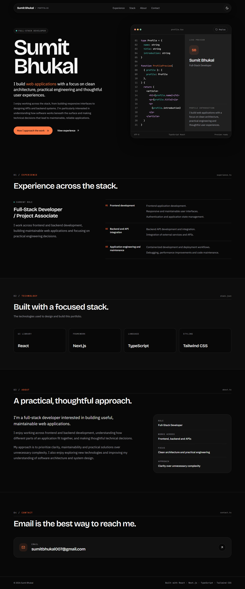
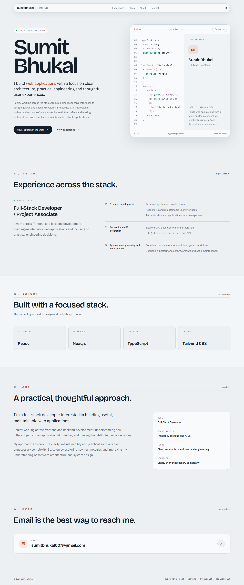

# Sumit Bhukal — Portfolio

Personal portfolio of Sumit Bhukal, a full-stack developer. It is a single-page site built with Next.js, React, TypeScript and Tailwind CSS v4.

| Dark theme | Light theme |
| --- | --- |
|  |  |

## Status

Version 2 is in active development. It has not been deployed yet. Search indexing is disabled (`noindex, nofollow`) until a public launch is approved.

## Features

- Responsive layout, tested from 320 px phones up to wide desktop screens.
- Light, Dark and System themes. One control cycles between them, and the choice is remembered in the browser.
- A code-editor panel in the hero types out a small React component next to a live preview. It has a Replay control and pauses while scrolled out of view.
- Experience, technology and about sections.
- Accessible navigation: skip link, active-section indicator, visible focus states and keyboard support.
- Reduced-motion support: the typing animation and smooth scrolling are turned off when the operating system asks for reduced motion.
- No public email address. A contact form is planned; until it exists the Contact section is hidden.

## Technology

- [Next.js](https://nextjs.org/) 16 (App Router)
- [React](https://react.dev/) 19
- [TypeScript](https://www.typescriptlang.org/) 5
- [Tailwind CSS](https://tailwindcss.com/) v4
- [next-themes](https://github.com/pacocoursey/next-themes) for theme switching
- [Lucide](https://lucide.dev/) icons
- [Bun](https://bun.sh/) as the package manager, with Node.js as the runtime
- [Playwright](https://playwright.dev/) and [axe-core](https://github.com/dequelabs/axe-core) for end-to-end and accessibility tests

Fonts (Bricolage Grotesque, IBM Plex Sans, JetBrains Mono) are self-hosted from `app/fonts/` under the SIL Open Font License. The license texts are included next to the font files.

## Getting started

### Prerequisites

- Node.js 24.x. `package.json` pins `24.21.0`.
- Bun 1.4.4 or a compatible 1.x release.

### Install and run

```bash
bun install --frozen-lockfile
bun run dev
```

Then open <http://localhost:3000>.

### Validation

```bash
bun run lint            # ESLint
bunx tsc --noEmit       # Type-check
bun run build           # Production build
bun run test -- --workers=1   # Playwright end-to-end tests
```

The first time you run the tests, install the Chromium browser. The Playwright config stores browsers in the ignored `.playwright-browsers/` directory:

```bash
# macOS / Linux
PLAYWRIGHT_BROWSERS_PATH=.playwright-browsers bunx playwright install chromium

# Windows (PowerShell)
$env:PLAYWRIGHT_BROWSERS_PATH=".playwright-browsers"; bunx playwright install chromium
```

`bun run test` starts the development server on port 3000 automatically. If a server is already running there, the tests reuse it.

No environment variables are needed.

### Commit safeguard

`.githooks/pre-commit` is a small POSIX shell script. It blocks commits that stage private working files (the ignored `.local/` directory, IDE state, local agent links) or `.env` files. Git does not enable repository hooks automatically, so turn it on once per clone:

```bash
git config core.hooksPath .githooks
```

## Project structure

```text
app/
  layout.tsx        Root layout, fonts, metadata, theme provider
  page.tsx          Homepage composition
  globals.css       Tailwind v4 entry point, theme tokens, base styles
  fonts/            Self-hosted fonts and their licenses
  icon.png, apple-icon.png, favicon.ico
components/         Section components (hero, experience, skills, about, contact, …)
data/
  portfolio.ts      All editable portfolio content
e2e/
  homepage.spec.ts  Playwright end-to-end and accessibility tests
docs/screenshots/   Images used in this README
tailwind.config.ts  Legacy theme configuration, loaded by globals.css through @config
```

## Architecture

- The homepage is a single route made of Server Components. Only the interactive parts are Client Components: the hero workspace animation, the navigation's active-section tracking and the theme toggle.
- Content is kept separate from presentation. Profile text, experience, technologies, about facts, contact details, navigation and metadata all live in `data/portfolio.ts`.
- Light and dark theme colours are CSS variables defined in `app/globals.css` and exposed to Tailwind.
- There is no backend, database or API.

## Customizing content

Edit `data/portfolio.ts`:

- `profile`, `about`, `aboutFacts`: name, title and biography.
- `experience`: roles and grouped responsibilities. Dates are optional.
- `skills`: the technology cards.
- `contact`, `socialLinks`: contact methods. The Contact section and its navigation link appear only when one exists.
- `projects`: project cards. The Work section and its navigation link appear only when this array is not empty, and section numbers update automatically.

## Testing and accessibility

The Playwright suite in `e2e/homepage.spec.ts` covers:

- content rules
- theme cycling and persistence
- following the system theme
- navigation anchors
- heading structure
- mobile tap targets and horizontal overflow
- metadata and indexing rules
- the hidden Contact section
- the skip link
- reduced motion
- the workspace animation
- hydration errors
- automated WCAG 2.2 AA checks with axe in both themes

Automated checks catch only part of what affects accessibility. Manual screen-reader testing has not been documented yet.

## Limitations

- Projects are not shown yet. Independent personal projects will be added in a future update once they are complete and verified.
- There is no canonical domain, social share image, sitemap or `robots.txt` yet. These depend on the final domain.
- The tests run in Chromium only. Other browsers have not been tested systematically.
- `tailwind.config.ts` is a leftover from the Tailwind v3 setup and still provides some theme values.

## Roadmap

- Add up to three verified independent personal projects, possibly with detail pages.
- Choose a domain, then add canonical metadata, a share image and sitemap/robots files.
- Deploy, and enable indexing after the public version has been reviewed.

## License

No license has been chosen yet. Until one is added, all rights are reserved by the author.
